# YouFlix: Netflix-style UI for YouTube

YouFlix is a Chrome extension that gives YouTube a Netflix-style interface. You get a profile picker, an autoplaying billboard, sliding rows with hover previews, a detail modal with episodes, a Top 10 row, and a Netflix-style video player. The videos, your account, your history and your recommendations all still come from YouTube.

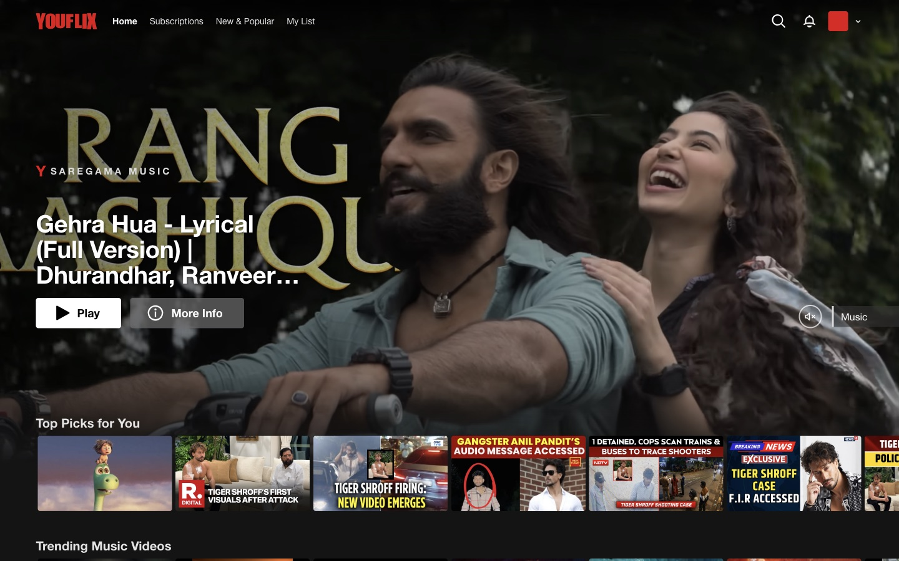

---

## Contents

- [Features](#features)
- [Install](#install)
- [Using YouFlix](#using-youflix)
- [Keyboard shortcuts](#keyboard-shortcuts)
- [Settings](#settings)
- [How it works](#how-it-works)
- [Privacy](#privacy)
- [Troubleshooting](#troubleshooting)
- [Known limitations](#known-limitations)
- [Updating and uninstalling](#updating-and-uninstalling)

---

## Features

| | |
|---|---|
| **Who's watching?** screen, shown once per browser session | 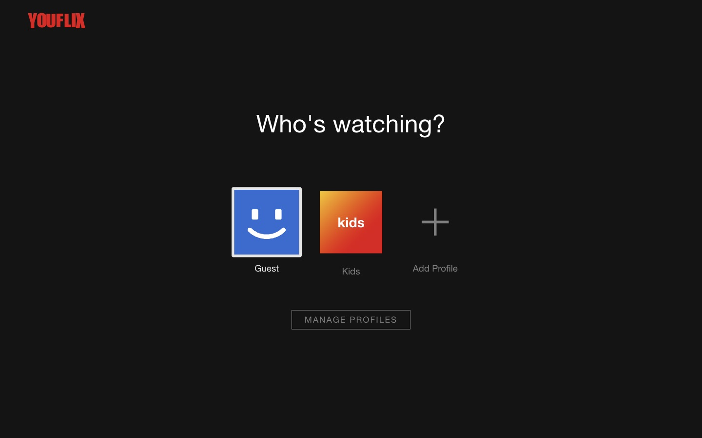 |
| **Hover previews.** Hover a title and the card grows into a muted preview with Play, My List, Like and More Info | 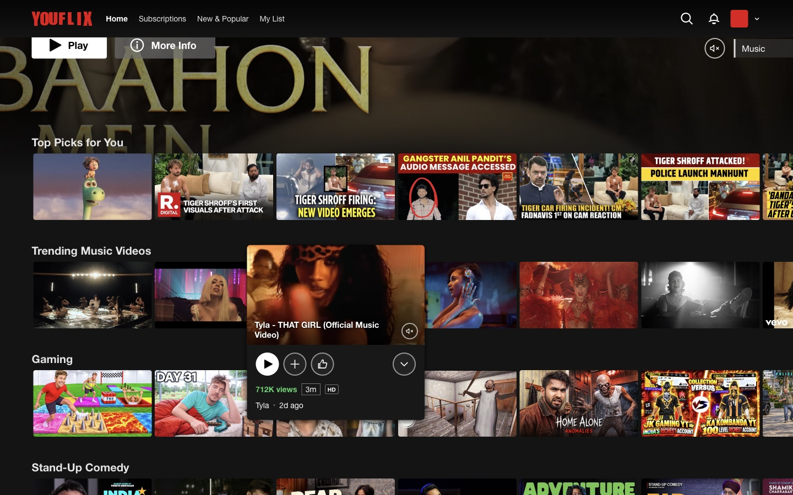 |
| **Detail modal** with description, channel, genres, an **Episodes** list (the channel's latest uploads) and **More Like This** | 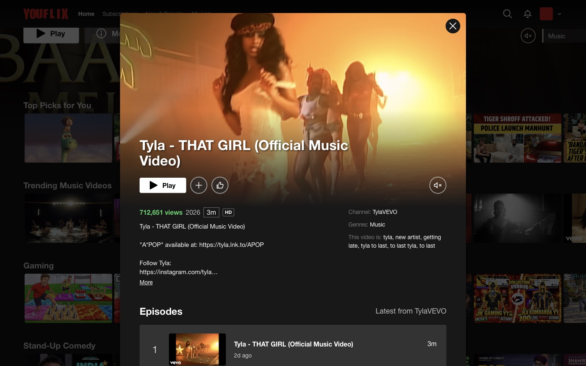 |
| **Episodes** view inside the modal | 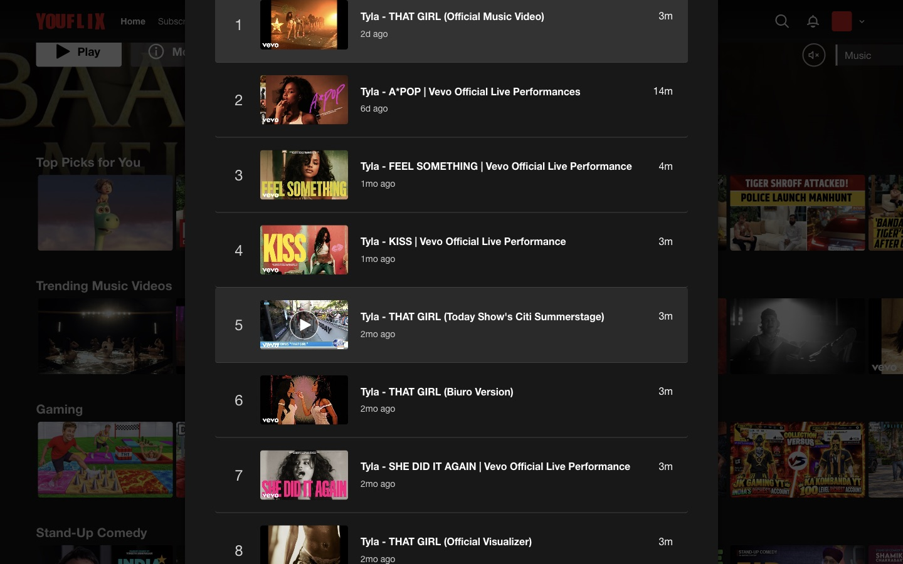 |
| **New & Popular** with a **Top 10** row drawn with large outlined numbers | 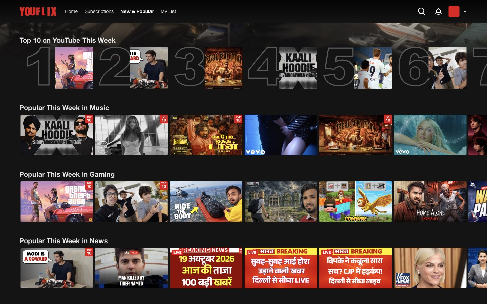 |
| **Search** results laid out as a grid, with "Explore titles related to" channel links | 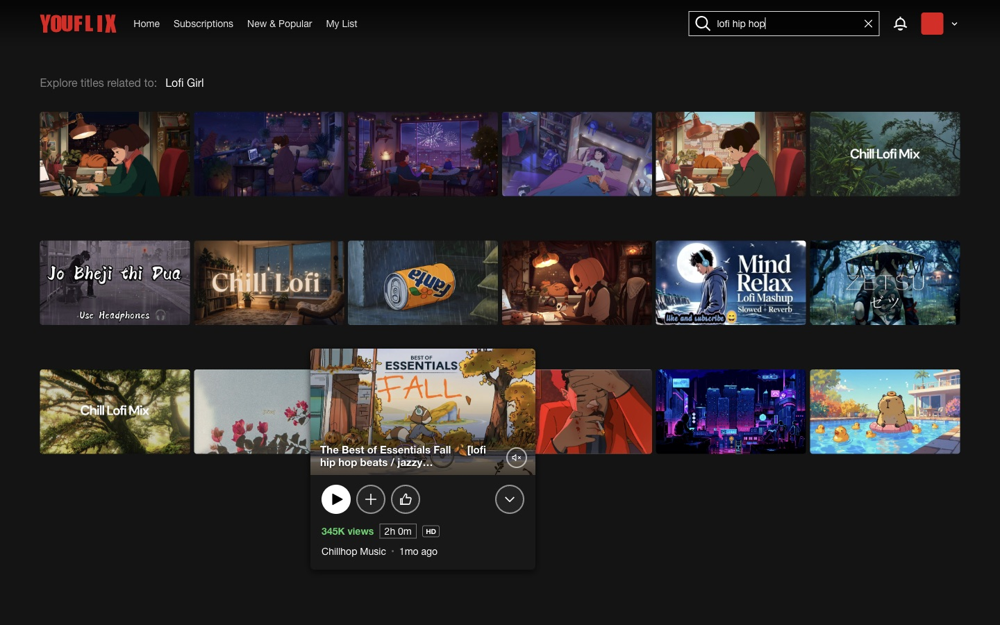 |
| **Channel pages** shown as a series: billboard, Latest Episodes, the channel's shelves and playlists | 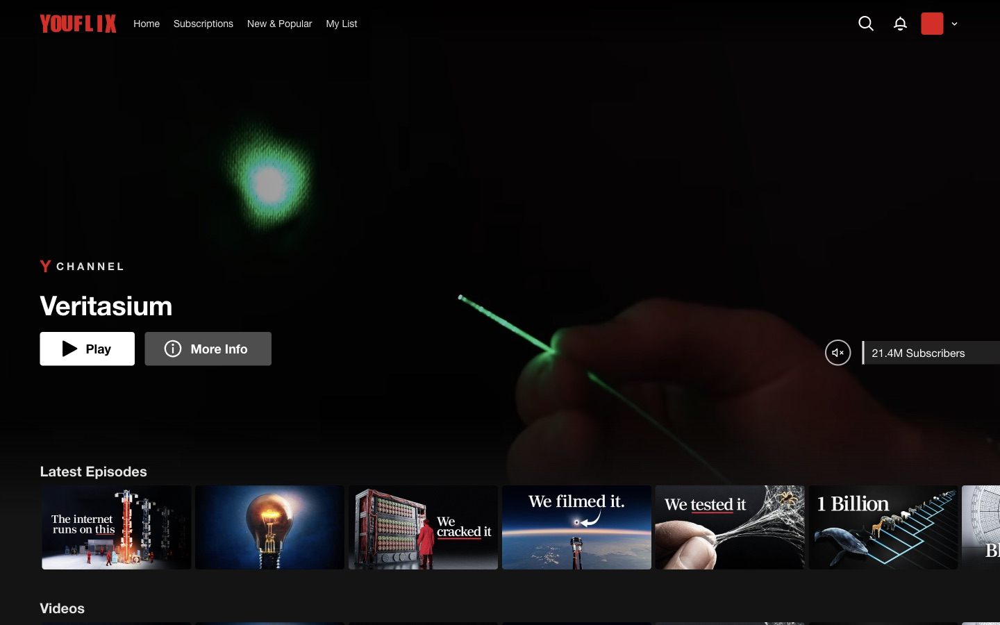 |
| **Netflix-style player**: red scrubber with frame previews, ±10 s, volume, Next Episode, Episodes, Subtitles, Speed, Fullscreen | 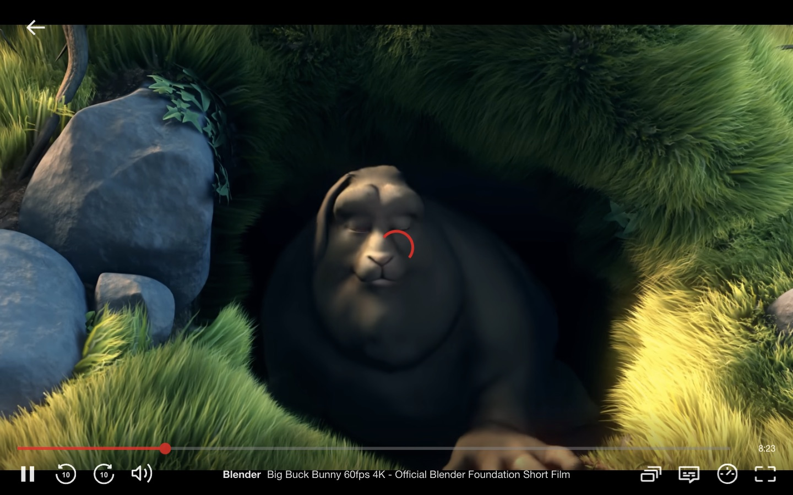 |
| **Playback speed** panel | 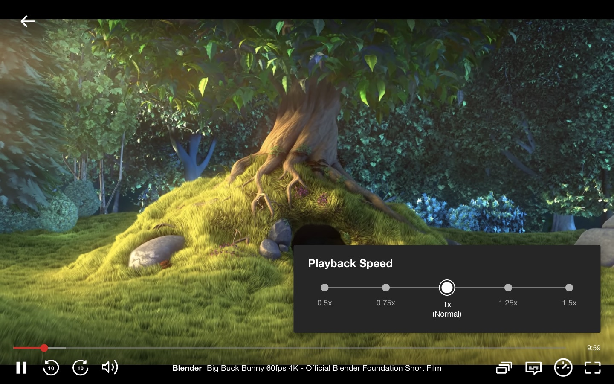 |
| **"You're watching"** screen that appears after 5 seconds paused |  |

Home rows when you are signed in to YouTube:

- Continue Watching (with red progress bars)
- Top Picks for You
- Top 10 in Your Feed Today
- New from Your Subscriptions
- My List (your **Watch Later**)
- Because You Watched …
- Watch It Again
- Liked Videos
- Genre rows: Music, Gaming, Comedy, Documentaries, Trailers, Science, Sports, Food, Travel, News

When you are signed out, YouFlix fills the page from the genre rows, so it is never empty.

---

## Install

YouFlix isn't on the Chrome Web Store, so you load it as an unpacked extension. It takes about a minute and works in **Chrome, Edge, Brave, Arc, Opera and Vivaldi** (any Chromium browser, version 111 or newer).

### 1. Get the code

```bash
git clone https://github.com/ashusnapx/yt-netflix.git
```

Or click **Code → Download ZIP** on GitHub and unzip it. Keep the folder somewhere permanent: the browser loads the extension from that folder every time it starts.

### 2. Turn on Developer mode

1. Open `chrome://extensions` (`edge://extensions` in Edge, `brave://extensions` in Brave).
2. Switch on **Developer mode** in the top-right corner.

### 3. Load the folder

1. Click **Load unpacked**.
2. Select the `yt-netflix` folder, the one that contains `manifest.json`.
3. **YouFlix** appears in the list. Make sure its toggle is on.

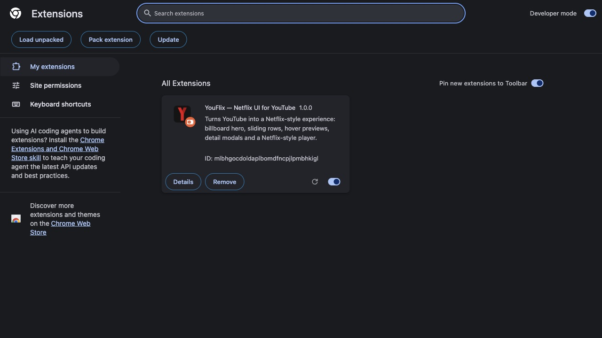

### 4. Pin it (optional)

Click the puzzle-piece icon in the toolbar, then the pin next to **YouFlix**. This keeps the settings popup one click away.

### 5. Open YouTube

Go to <https://www.youtube.com>. If a YouTube tab was already open, reload it.

---

## Using YouFlix

### Profile screen

Pick your profile to enter. Your YouTube avatar and name are shown when you are signed in. **Kids** opens YouTube Kids. **Add Profile** and **Manage Profiles** open YouTube's channel switcher, so brand-account channels act as profiles.

### Browsing

- The **header** links to Home, Subscriptions, New & Popular and My List. It turns solid once you scroll.
- **Rows:** hover a row to show the ‹ › arrows and the page indicator. Click **Explore All ›** on a row title to open the full list.
- **Hover a title** for about half a second to expand it. A muted preview starts shortly after.
  - ▶ plays the video.
  - ＋ adds it to **My List** (YouTube *Watch Later*). Click ✓ to remove it.
  - 👍 likes the video on YouTube.
  - ⌄ opens the detail modal.
- **Click a title** to open the detail modal.
- **Ctrl/⌘-click or middle-click** a title to open it in a new tab.
- The **sound button** on the billboard unmutes previews. When the billboard trailer finishes, the same button becomes ↻ (replay).
- **Search:** click 🔍 and type. Results load as you type.
- **🔔 Notifications** lists the newest videos from your subscriptions.
- The **avatar menu** links to your channel, Watch History, Liked Videos, Playlists and Account. It also has **Switch to classic YouTube** and sign out.

### Watching

Press **Play** anywhere to open the full-screen player. Move the mouse to bring up the controls. They hide again after 3 seconds while a video plays and stay visible while it is paused.

- **← (top left):** back to the page you were browsing.
- **Scrubber:** click or drag to seek. Hover it to see a frame preview and the timestamp.
- **Time** at the right of the scrubber shows how much is left.
- **Next Episode** (⏭) plays YouTube's next video. A white **Next Episode** button also appears during the last 20 seconds.
- **Episodes** (stacked squares) lists the current playlist, or Up Next if you aren't watching a playlist.
- **Subtitles** (speech bubble) turns YouTube captions on and off. Captions use Netflix's look: plain white text with a soft shadow.
- **Speed** (gauge): 0.5× to 1.5×.
- **Fullscreen** (corners), or double-click the video.

YouTube ads play as usual. During an ad, YouFlix hides its controls so YouTube's **Skip** button stays clickable.

---

## Keyboard shortcuts

In the player:

| Key | Action |
|---|---|
| `Space` / `K` | Play / pause |
| `←` / `J` | Back 10 seconds |
| `→` / `L` | Forward 10 seconds |
| `↑` / `↓` | Volume up / down |
| `M` | Mute / unmute |
| `F` | Fullscreen |
| `Shift` + `N` | Next episode |
| `Esc` | Close a panel, or leave fullscreen |

While browsing, `Esc` closes the detail modal or the profile screen.

---

## Settings

Click the YouFlix icon in the toolbar:

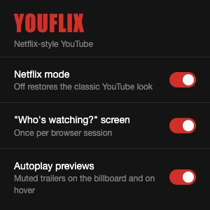

| Setting | What it does |
|---|---|
| **Netflix mode** | Master switch. Turn it off to get the normal YouTube interface back (the page reloads). |
| **"Who's watching?" screen** | Shows the profile picker once per browser session. |
| **Autoplay previews** | Plays muted trailers on the billboard, on hover cards and in the detail modal. |

You can also leave Netflix mode from the avatar menu or the page footer: **Switch to classic YouTube**.

---

## How it works

```
manifest.json      MV3 manifest
src/bridge.js      Runs in the page's own JavaScript world: drives YouTube's router,
                   reads the player API, signs Watch Later / Like requests
src/data.js        Fetches YouTube pages with your session and turns their data into
                   plain video, shelf and channel objects
src/ui.js          Header, billboard, rows, hover cards, modal, grids, profile screen
src/player.js      Netflix-style controls on top of YouTube's own <video>
src/main.js        Boot, router and keyboard handling
src/ui.css         Styles for the Netflix UI (inside a Shadow DOM, so YouTube's CSS can't leak in)
src/page.css       Page-level rules: hide YouTube's chrome, make the player full-bleed
preview.html/.js   Hosts the inline previews (see Privacy)
rules.json         Adds a Referer header to the preview embeds, and to nothing else
popup.html/.js     Settings popup
```

- **YouTube still runs underneath.** YouFlix hides YouTube's interface and draws its own. Navigation goes through YouTube's single-page router, so the back button, history and URLs all behave normally.
- **The player is YouTube's real player.** Only the controls are replaced. Quality selection, ads, captions, autoplay and watch-history tracking still work the way YouTube does them.
- **Pages YouFlix doesn't redesign** (Shorts, Studio, Settings, uploads and so on) show the normal YouTube interface.

---

## Privacy

- YouFlix has **no server, no analytics and no tracking**. It only talks to `youtube.com` and `youtube-nocookie.com`.
- Requests to YouTube carry your normal YouTube cookies, exactly as if you browsed YouTube yourself. Your session never leaves YouTube.
- **Previews never touch your watch history.** They play through YouTube's privacy-enhanced `youtube-nocookie.com` embed, inside an extension page (`preview.html`). YouTube refuses embeds placed directly on youtube.com.
- The `declarativeNetRequest` rule in `rules.json` only matches embed URLs that YouFlix itself marks with `ytnf=1`.
- Permissions: `storage` (your three settings), `declarativeNetRequestWithHostAccess` (the Referer rule above), and access to `youtube.com` and `youtube-nocookie.com`.

---

## Troubleshooting

**YouTube looks normal.**
Check that the extension is on in `chrome://extensions` and that **Netflix mode** is on in the popup. Then reload the YouTube tab.

**Rows are missing or empty.**
Most rows (Continue Watching, Subscriptions, My List, Liked) need you to be **signed in to YouTube**. Signed out, you only get the genre rows.

**Previews don't play.**
Check that **Autoplay previews** is on. Some videos (often music videos) don't allow embedding. Those show the still image, which is expected.

**The video is cropped, or the player controls are off-screen.**
Check that the browser zoom is 100% (`⌘0` / `Ctrl+0`). If you test with automation tools, don't force a viewport larger than the window.

**Something broke after a YouTube update.**
YouTube changes its page structure from time to time. Turn **Netflix mode** off to keep watching, and open an issue with the URL and any `[YouFlix]` lines from the DevTools console.

**I changed the code and nothing happened.**
Click the ↻ reload icon on the YouFlix card in `chrome://extensions`, then reload YouTube. To check the data parsers, run `node test/data.test.js`.

---

## Known limitations

- Each row shows what one YouTube page returns, about 20 to 40 titles. Rows don't scroll infinitely.
- Subtitles can be switched on and off, but caption *language* is still chosen in YouTube's own menu (press `C`, then use the YouTube settings).
- Shorts, YouTube Studio and the account settings pages keep the normal YouTube design.
- YouFlix is an **unofficial fan project**. It isn't affiliated with Netflix or YouTube, and all video content belongs to its creators.

---

## Updating and uninstalling

- **Update:** `git pull` in the folder (or download the ZIP again into the same folder), then click ↻ on the YouFlix card in `chrome://extensions`.
- **Turn off temporarily:** switch off **Netflix mode** in the popup.
- **Uninstall:** click **Remove** on the YouFlix card in `chrome://extensions`.
